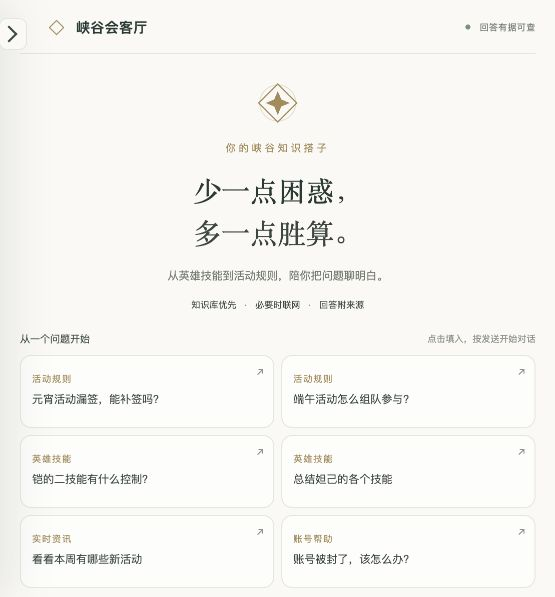
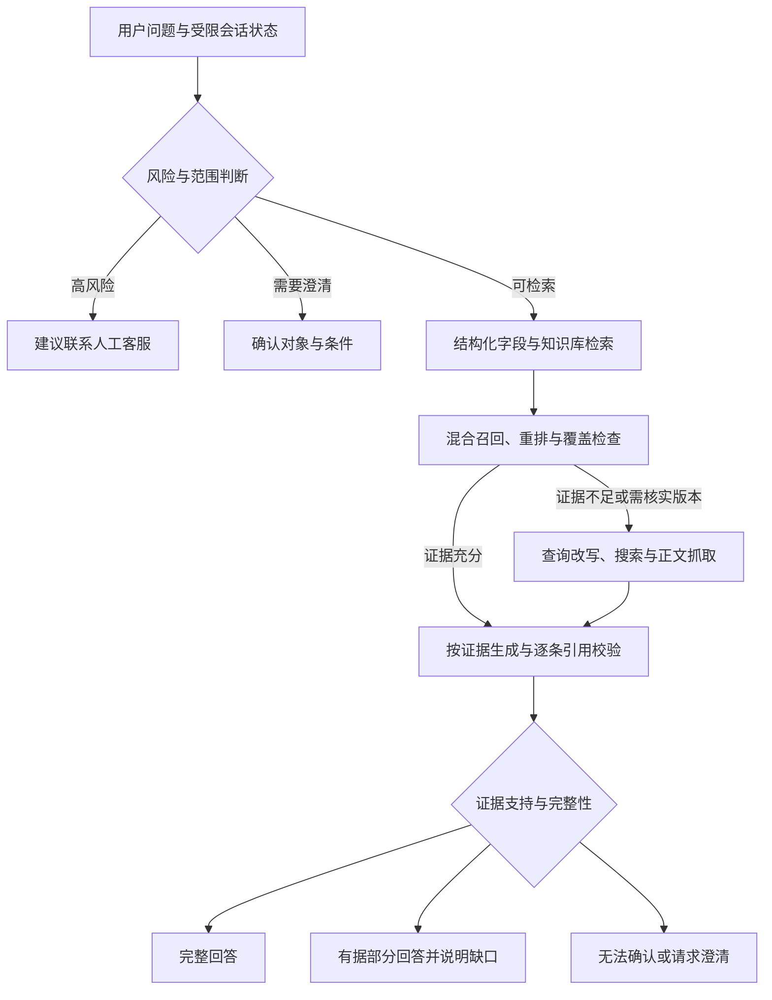

# 游戏客服 Agentic RAG · 项目展示

**从客服业务问题出发，探索有来源、能衔接上下文、可核验的游戏问答助手。**

Python · Gradio · BGE-M3 · 向量与BM25混合检索 · 联网补充 · 引用校验

> 这是个人项目案例展示，包含实际界面、方案设计、验证摘要和11份核心代码快照。原始知识数据、索引、模型、密钥及完整运行环境未分发，当前仓库不提供开箱即用的部署。项目为非官方技术演示，与游戏运营方无隶属关系。

## 业务问题

游戏客服问题既有相对稳定的英雄与玩法知识，也有随版本变化的活动、奖励和规则。单纯让模型回答容易缺少来源；只查固定知识库，又容易拒绝库外或实时问题。高风险账号问题还涉及普通问答无法代替的人工处理。

本项目围绕三个目标展开：

- **可答**：简单事实尽量直接从结构化官方字段取证，多轮追问保留用户对象和条件。
- **可信**：知识库不足时实际联网，区分历史、当前及体验服证据，答案附来源。
- **可控**：证据不全时部分回答、澄清或无法确认；记录真实用量，控制本机资源和外部调用。

## 实际界面

对话界面支持模型选择、检索阈值、可点击来源；路由决策、耗时和费用估算默认折叠。

截图取自实际运行的演示界面。展示的职业查询使用已有官方字段，未调用生成模型或付费搜索。没有将模拟回答渲染成实测结果。

## 方案架构

路由决定下一步采用什么策略，不能仅凭LLM预判“知识库里有没有”。个人账号数据未接入时，也不能用公开规则冒充该账号的真实状态。

详见[架构与设计取舍](docs/architecture.md)。

## 已实现的能力

|能力|实际行为|
|---|---|
|结构化事实|职业、推荐分路、称号、命名技能说明与装备价格按官网已收录字段回答|
|混合检索|向量与BM25召回，RRF融合，LLM重排；按任务补足父文档和对象覆盖|
|联网补充|保留原问题限制，按缺失依据改写查询；正文作为数据处理，不执行网页指令|
|来源与时效|区分正式公告、官网托管攻略、第三方和体验服；发布日期与抓取日期分别记录|
|多轮问答|有限会话状态用于补全指代、年份与条件，不把历史答案当作新事实|
|引用校验|证据ID与原文对应，程序校验引用，再做语义核验；部分回答单独标记|
|维护|官方目录和系统公告增量更新，候选验证通过后原子切换，失败保留旧版|
|演示体验|对话式Gradio界面、折叠详情、费用参考估算、带密码的临时公网分享|
|资源控制|本机与公网共用单人处理队列，避免重复加载模型；变化切片才重新向量化|

## 数据与验证

原项目包含110篇活动与基础演示文档，以及另行收录的官方目录与公告资料。演示文档不冒充真实现行活动；目录条目也不能直接等同于当前游戏的全部英雄或皮肤。

|原项目检查|结果|口径|
|---|---:|---|
|程序回归|401/401|2026-10-26原工程记录；不是401道真实问答准确率|
|固定策略矩阵|176/176|2026-10-25；检查分类、历史范围与时效策略|
|实际结构化查询|939/939|2026-10-25；禁用外部接口，对照已保存的官方原始字段|
|临时公网演示|通过|真实验证密码、SSE问答、控制隔离和关闭；该次问答模型与搜索用量均为0|

这些结果来自原工程的冻结记录，**并非从本展示仓库重新运行得到，也不代表当前全量问题准确率**。比较类问题与部分现行规则的完整证据仍有缺口，未用程序检查数量掩盖它们。

详见[验证与已知边界](docs/evaluation.md)及[机器可读摘要](evidence/validation-summary.json)。

## 我的工作与AI协作

个人工作包括业务需求定义、方案取舍、问题反馈、迭代优先级、评测标准和结果验收。先使用DeepSeek协助形成框架，再使用Codex协助实现代码、测试和问题修复。

本项目属于 **AI辅助开发的个人实践**，不将AI生成的实现与测试表述为全部手写。方案价值通过业务问题、设计理由、实际演示、验证记录及已知限制共同说明。

## 阅读代码

|关注点|代码快照|
|---|---|
|整体问答流程|[pipeline.py](code/agent/pipeline.py)|
|任务计划与证据策略|[planning.py](code/agent/planning.py)、[question_policy.py](code/agent/question_policy.py)|
|混合检索|[retrieval.py](code/agent/retrieval.py)|
|多轮指代与范围|[conversation.py](code/agent/conversation.py)|
|原文引用与语义约束|[evidence.py](code/agent/evidence.py)、[semantic_guards.py](code/agent/semantic_guards.py)|
|资料更新事务|[update_reference.py](code/agent/update_reference.py)|
|对话界面与临时分享|[gradio_app.py](code/app/gradio_app.py)、[sharing.py](code/app/sharing.py)|
|分项判分|[quality.py](code/eval/quality.py)|

代码保留原文件间的依赖引用，作为实现节选阅读，不能当作完整可运行软件包。范围与指纹见[快照说明](code/README.md)。

## 演示与边界

- 当前仓库提供静态项目展示；需要交互体验时可由作者另行提供有时限、有密码的演示，不发布长期有效的访问凭据。
- 还不是生产客服系统，未接入人工坐席或个人账号数据，不承诺覆盖全部常识、活动与实时规则。
- 模型输出仍可能存在引用或语义错误；官方资料收录也不等于已认证适用最新正式服。
- 代码与文档的展示范围、第三方权利及未分发内容见[说明](NOTICE.md)。
